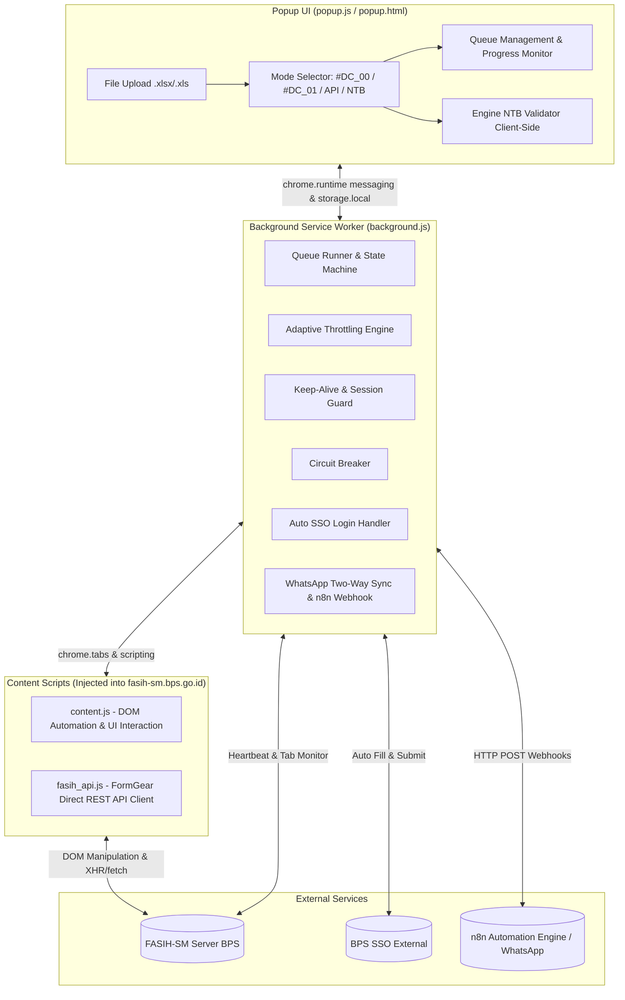

# CONTEXT.MD — TUNTAS SE2026 (Tracking dan Tindak Lanjut Anomali Sensus)

> **Dokumen Konteks Proyek & Panduan Teknis Komprehensif**  
> Terakhir diperbarui: 25 Oktober 2026  
> Zona Waktu Sistem: Waktu Indonesia Tengah (WITA / Asia/Makassar / UTC+8)

---

## 1. 📌 Ringkasan Proyek (Project Overview)

### 1.1 Identitas Proyek
- **Nama Aplikasi**: TUNTAS SE2026 (Tracking dan Tindak Lanjut Anomali Sensus)
- **Tipe Proyek**: Google Chrome Extension (Manifest V3)
- **Versi**: `1.0.0`
- **Lisensi**: Proprietary (dengan komponen pihak ketiga MIT License, lihat `THIRD_PARTY_LICENSES.txt`)
- **Target Platform**: Browser Google Chrome / Chromium-based (Edge, Brave) pada sistem operasi Windows/Linux/macOS

### 1.2 Konteks Bisnis & Masalah yang Diselesaikan
Dalam pelaksanaan **Sensus Ekonomi 2026 (SE2026)** oleh **Badan Pusat Statistik (BPS)**, ribuan dokumen survei yang dientri melalui platform web **FASIH-SM** (`https://fasih-sm.bps.go.id`) dan dimonitor melalui **PANTAU BPS** mengalami anomali atau flagging (misalnya anomali Rasio Nilai Tambah Bruto / NTB Flag 3, inkonsistensi KBLI, atau peringatan batas wajar).

Penyelesaian anomali secara manual membutuhkan waktu yang sangat masif:
1. Membuka assignment satu per satu, mengklik tombol edit, mencari rincian unit usaha.
2. Memberikan catatan konfirmasi lapangan (misalnya `#DC_00`), mengaktifkan toggle konfirmasi galat, menyimpan catatan.
3. Mengganti kode KBLI (catatan `#DC_01`) baik via daftar rekomendasi maupun Master KBLI.
4. Menghitung manual selisih pendapatan vs pengeluaran untuk menentukan rasio NTB wajar vs anomali.
5. Melakukan pengiriman kuesioner (*Submit*) dan proses persetujuan pengawas (*Approve* / *Revoke* jika sudah terlanjur approve).

**TUNTAS SE2026** diciptakan sebagai asisten otomasi cerdas end-to-end yang mengintegrasikan pengolahan data lokal, validasi bisnis statistik resmi BPS, manipulasi DOM kuesioner FASIH-SM, manipulasi variabel langsung melalui API FASIH internal, hingga kendali jarak jauh terdistribusi melalui WhatsApp & Webhook n8n.

---

## 2. 🏗️ Arsitektur Sistem & Tumpukan Teknologi (Tech Stack)

### 2.1 Arsitektur Ekstensi (Chrome Extension MV3)
Aplikasi dibangun di atas standar modern **Chrome Extension Manifest V3**, tanpa dependensi framework runtime eksternal (100% Vanilla JavaScript, CSS3, dan HTML5), sehingga ringan, cepat, dan sepenuhnya independen dari server backend khusus.



### 2.2 Komponen Teknologi Utama
| Komponen | Pustaka / Teknologi | Peran & Tanggung Jawab |
|---|---|---|
| **Core Extension** | Manifest V3, Web Extensions API | Izin: `storage`, `unlimitedStorage`, `tabs`, `activeTab`, `scripting`, `alarms` |
| **Excel Parser & Generator** | SheetJS (`lib/xlsx.full.min.js`) | Membaca & menulis file Excel (`.xlsx`, `.xls`) 100% lokal di browser tanpa koneksi internet |
| **NTB Engine** | `lib/ntb_validator.js` | Klasifikasi 22 sektor KBLI, formula rasio NTB riil, auto-imputasi median, ekspor 3-sheet |
| **DOM Automation** | `content/content.js` | Navigasi SPA kuesioner, penanganan kuesioner UB vs Non-UB, input catatan, toggle konfirmasi, submit & approve |
| **FASIH API Client** | `content/fasih_api.js` | Manipulasi FormGear internal, enkripsi/kompresi ZIP-CRC32-MD5, backup/restore JSON variabel |
| **Queue & Resiliensi** | `background/background.js` | Service worker MV3 keep-alive, antrian kerja, pemantauan latensi, jeda dinamis, circuit breaker |
| **Telemetri & Remote** | n8n Webhook & WhatsApp Bot | Notifikasi real-time ke grup WA, sinkronisasi status dua arah, remote control (`#STATUS`, `#JEDA`, `#LANJUT`, `#STOP`, `#TAMBAH`) |

---

## 3. 📂 Struktur Direktori & Penjelasan Modul

```
Anomali/
├── manifest.json            # Manifest V3: Permissions, Host Permissions, Content Scripts, Worker
├── README.md                # Panduan operasional bagi pengguna dan dokumentasi fitur
├── context.md               # [File Ini] Dokumentasi konteks arsitektur & referensi teknis pengembang
├── THIRD_PARTY_LICENSES.txt # Lisensi dependensi pihak ketiga (SheetJS, Fasih Batch Extension MIT)
├── logo.jpeg                # Logo visual identitas ekstensi
├── icons/                   # Aset icon ekstensi (16, 32, 48, 128 px)
│   ├── icon16.png
│   ├── icon32.png
│   ├── icon48.png
│   └── icon128.png
├── lib/                     # Pustaka logika pendukung & utility
│   ├── xlsx.full.min.js     # SheetJS library (minified) untuk operasi spreadsheet
│   └── ntb_validator.js     # Engine komputasi & validasi NTB Flag 3 (Client-side)
├── popup/                   # Antarmuka pop-up kontrol ekstensi
│   ├── popup.html           # Struktur UI antarmuka (Tab menu, upload, tabel antrian, monitor)
│   ├── popup.css            # Styling visual modern, responsif, dark/light accents, badges
│   └── popup.js             # Controller UI: handling event, parsing file, sinkronisasi storage
├── background/              # Logika service worker latar belakang
│   └── background.js        # Controller utama: antrian, tab lifecycles, keep-alive, throttle, webhook
├── content/                 # Script injeksi ke halaman FASIH BPS
│   ├── content.js           # Robot DOM: alur klik form kuesioner, catatan, toggle, submit, approve
│   └── fasih_api.js         # API Engine: modifikasi data kuesioner langsung via endpoint FormGear
└── template/                # Format template Excel standar siap pakai
    ├── Template_TUNTAS_DC0.xlsx          # Template Mode #DC_00 (link_fasih_sm)
    ├── Template_TUNTAS_DC1_KBLI.xlsx     # Template Mode #DC_01 (link, kbli_awal, kbli_tujuan)
    ├── Template_TUNTAS_API_Variabel.xlsx # Template Mode API (link, nama_usaha, kode_catatan, vars)
    └── Template_TUNTAS_NTB_Pantau.xlsx   # Format kolom ekspor PANTAU BPS
```

---

## 4. ⚙️ Empat Mode Operasi Utama

Ekstensi menyediakan 4 mode kerja terintegrasi yang dapat dipilih dari tab atas pada popup:

### 4.1 Mode 1: `#DC_00` · Tanpa Perubahan (Konfirmasi Wajar)
- **Tujuan**: Memberikan catatan konfirmasi `#DC_00` pada unit usaha yang anomali/flagging-nya sudah sesuai kondisi lapangan yang wajar.
- **Input File**: File Excel berisi kolom wajib `link_fasih_sm` (atau hasil filter status `#0` dari menu NTB).
- **Logika Penargetan Pertanyaan Catatan**:
  1. **Kuesioner `SE2026 - UB` (Usaha Buka / Usaha Baru)**:
     - Membuka sidebar **BLOK I (IDENTITAS USAHA/PERUSAHAAN)**.
     - Pertanyaan target: **`23. Rincian Nilai produksi Tahun 2025 - a. Nilai produksi barang dan jasa*`** (atau variabel `r23a`).
  2. **Kuesioner Non-UB (seperti `SE2026 - L`)**:
     - Membuka sidebar **BLOK II (KETERANGAN USAHA/PERUSAHAAN)**.
     - Membuka dropdown unit usaha yang sesuai.
     - Memeriksa pertanyaan **`25. Tahun berapa usaha/perusahaan ini mulai beroperasi secara komersial?`**:
       - Jika tahun $\le 2025$: Catatan diberikan pada pertanyaan **`27. a. Nilai produksi/pendapatan/penjualan barang dan jasa`** (atau opsi alternatif `13.g` Kode KBLI jika dipilih di pengaturan).
       - Jika tahun $> 2025$: Catatan diberikan pada pertanyaan **`31. a. Nilai pendapatan barang dan jasa*`**.
- **Aksi Lanjutan**: Mengaktifkan toggle switch konfirmasi galat pada modal catatan $\rightarrow$ Simpan catatan $\rightarrow$ Buka menu CATATAN di sidebar $\rightarrow$ Aktifkan toggle "Tampilkan Anomali Usaha dan Keluarga" $\rightarrow$ Kirim survei $\rightarrow$ Auto Approve.

### 4.2 Mode 2: `#DC_01` · Ganti KBLI
- **Tujuan**: Memperbaiki kode KBLI unit usaha yang keliru secara otomatis.
- **Input File**: File Excel berisi kolom `link_fasih_sm`, `kbli_awal`, dan `kbli_tujuan` (opsional `nama_usaha`).
- **Alur Kerja**:
  1. Membuka kuesioner dan menuju BLOK II unit usaha target.
  2. Menemukan pertanyaan `13.g` (Kode KBLI) yang bernilai `kbli_awal`.
  3. Mencari `kbli_tujuan` pada radio button rekomendasi KBLI.
  4. **Fallback Master KBLI**: Jika tidak ada di rekomendasi radio, bot mengklik tombol reset/pilih dari Master KBLI (`div#kbli#...`), mengetik kode KBLI tujuan, memilih dari dropdown, dan memverifikasi keterpilihannya.
  5. Mengisi modal catatan pada `13.g` dengan teks `#DC_01`.
  6. Mengaktifkan toggle konfirmasi anomali, submit formulir, dan melakukan auto approve.

### 4.3 Mode 3: API · Ubah Variabel Massal
- **Tujuan**: Mengubah variabel kuesioner apa pun (selain KBLI) secara massal langsung melalui API internal FASIH FormGear tanpa klik manual form.
- **Workflow Interaktif**:
  1. *Pilih Variabel*: Pengguna membuka 1 kuesioner di tab aktif $\rightarrow$ klik "Pilih Variabel" di popup $\rightarrow$ ekstensi membaca struktur kuesioner $\rightarrow$ pengguna mencentang variabel yang ingin diubah.
  2. *Unduh Template*: Sistem men-generate file Excel berisi kolom `link_fasih_sm`, `nama_usaha`, `kode_catatan`, serta kolom variabel terpilih (misal `r26a`, `r26b`, `r27a`). Sheet kedua memuat kamus kode pilihan nilai.
  3. *Eksekusi Aman*:
     - **Mode Dry Run (Uji Coba)**: Default aktif. Memeriksa kecocokan dataKey tanpa menyimpan ke database.
     - **Auto Backup**: Menyimpan snapshot JSON kuesioner sebelum ditimpa (disediakan tombol Restore).
     - **Form Verification & Submission**: Setelah API menulis data, bot membuka halaman formulir secara visual untuk memastikan validasi FormGear lulus, lalu melakukan Submit dan Approve (dibatalkan otomatis jika muncul notifikasi GALAT merah).

### 4.4 Mode 4: NTB · Validasi & Imputasi (Flag 3)
- **Tujuan**: Menyelesaikan anomali Rasio Nilai Tambah Bruto (NTB Flag 3) dari file mentah PANTAU BPS secara instan, akurat, dan 100% *client-side*.
- **Workflow**:
  1. Pengguna mengunggah file ekspor mentah PANTAU BPS (`.xlsx` atau `.xls`).
  2. Engine `ntb_validator.js` melakukan parsing dan komputasi otomatis (lihat Bagian 5).
  3. Mengklasifikasikan tiap baris menjadi **#0 (Sesuai Batas Wajar)** atau **#1 (Anomali / Perlu Imputasi)**.
  4. Mengunduh hasil komprehensif dalam **File Excel 3-Sheet**:
     - *Sheet 1 (Master Validasi NTB)*: Seluruh kolom audit, diagnosa, dan rasio riil.
     - *Sheet 2 (Panduan Imputasi #1)*: Rekomendasi nominal dan instruksi naratif.
     - *Sheet 3 (Template API Siap Pakai)*: Format siap pakai untuk eksekusi API.
  5. **Dukungan Sheet 3 Kustom**: Pengguna dapat memodifikasi Sheet 3 sendiri (mengganti variabel imputasi dengan multi-variabel bebas seperti `r26a`, `r27b`, dsb.) dan mengunggahnya kembali.
  6. **Konversi ke Antrian Bot Langsung**: Pengguna dapat memfilter `Semua`, `Hanya #1`, atau `Hanya #0` untuk langsung dimuat ke antrian eksekusi bot FASIH tanpa perantara file lagi.

---

## 5. 🧠 Logika Matematika & Algoritma Khusus

### 5.1 Rumus Perhitungan Rasio NTB Riil
Sistem PANTAU BPS sering kali menampilkan anomali atau persen yang terdistorsi akibat formula agregasi sistem yang tidak konsisten. TUNTAS menghitung ulang secara independen:

$$\text{Total Pendapatan} = \text{Pendapatan B\&J} + \text{Pendapatan Lainnya}$$

$$\text{NTB Riil} = \text{Total Pendapatan} - \text{Total Pengeluaran}$$

$$\text{Rasio NTB (\%)} = \left( \frac{\text{NTB Riil}}{\text{Total Pendapatan}} \right) \times 100$$

### 5.2 Klasifikasi 22 Sektor KBLI (A–V) & Batas Rasio Wajar
`ntb_validator.js` memetakan nama usaha menggunakan pencocokan kata kunci kontekstual (regex/substring) ke kategori sektor ekonomi BPS:

| Kode | Kategori Sektor Ekonomi | Rentang Wajar (%) | Target Median (%) | Variabel Imputasi Default |
|:---:|---|:---:|:---:|:---:|
| **A** | Pertanian, Kehutanan, Perikanan | 19.0 – 30.0 | 25.0 | `r26b` (Bahan Baku / Bibit / Pakan) |
| **B** | Pertambangan & Penggalian | 28.0 – 81.0 | 50.0 | `r26d` (Biaya Operasional) |
| **C** | Industri Pengolahan | 33.0 – 67.0 | 45.0 | `r26b` (Bahan Baku / Produksi) |
| **D** | Pengadaan Listrik, Gas, Uap | 13.0 – 68.0 | 35.0 | `r26d` (Biaya Operasional) |
| **E** | Air, Sampah, Limbah & Remediasi | 29.0 – 47.0 | 38.0 | `r26d` (Biaya Operasional) |
| **F** | Konstruksi | 34.0 – 44.0 | 39.0 | `r26d` (Biaya Operasional) |
| **G** | Perdagangan Besar/Eceran; Reparasi Ranmor | 7.0 – 60.0 | 30.0 | `r26c` (Pembelian Barang Dagangan) |
| **H** | Transportasi dan Pergudangan | 7.0 – 60.0 | 35.0 | `r26d` (Operasional - BBM & Servis) |
| **I** | Penyediaan Akomodasi & Makan Minum | 7.0 – 60.0 | 35.0 | `r26b` (Bahan Makanan / Minuman) |
| **J** | Informasi & Komunikasi (Media, Konten) | 7.0 – 60.0 | 35.0 | `r26d` (Biaya Operasional) |
| **K** | Telekomunikasi, Pulsa/Voucher, Jasa IT | 7.0 – 60.0 | 30.0 | `r26c` (Pembelian Pulsa / Voucher) |
| **L–V**| Jasa Keuangan, Real Estat, Pendidikan, Jasa Lainnya | 15.0 – 100.0 | 25.0 – 30.0 | `r26d` (Biaya Operasional) |

### 5.3 Algoritma Imputasi Nilai Baru (Status #1)
Jika rasio berada di luar batas wajar ($< \text{min}$ atau $> \text{max}$):
1. **Kasus Pendapatan = 0 / Kosong**:
   $$\text{Pendapatan Baru (R27a)} = \max(\text{Total Aset} \times 0.5, \; 3.000.000)$$
   $$\text{Pengeluaran Target Baru} = \text{Round}_{10.000}\left(\text{Pendapatan Baru} \times \left(1 - \frac{\text{Target Median}}{100}\right)\right)$$
2. **Kasus Rasio Terlalu Tinggi ($> \text{Target}$)**:
   Pendapatan dipertahankan, biaya pengeluaran disesuaikan ke atas:
   $$\text{Pengeluaran Baru} = \text{Round}_{10.000}\left(\text{Total Pendapatan} \times \left(1 - \frac{\text{Target Median}}{100}\right)\right)$$
   Nilai baru diimputasikan ke variabel biaya target sektor terkait (`r26c`, `r26b`, atau `r26d`).
3. **Kasus Rasio Terlalu Rendah / Negatif / Impas ($0\%$)**:
   Jika terdapat pendapatan sampingan/lainnya, pendapatan utama disesuaikan atau pengeluaran ditekan agar rasio mencapai target wajar.

### 5.4 Adaptive Throttling Engine (Dynamic Rate Limiter)
Server FASIH-SM BPS sering kali mengalami lonjakan beban respon (*traffic spikes*). TUNTAS mengimplementasikan mesin kendali kecepatan adaptif di `background.js`:
- Mengukur latensi aktual setiap pemanggilan API, pembukaan tab, dan render formulir kuesioner.
- Mempertahankan riwayat buffer 8 sampel latensi terakhir.
- **Tingkat Kecepatan**:
  - 🟢 **NORMAL (Latensi < 1.5s)**: Multiplier `1.0x` (jeda standar 1.5s), jeda antrian `+0s`.
  - 🟡 **MILD (Latensi 1.8s – 4.0s)**: Multiplier `1.5x` (jeda ~2.3s), jeda antrian `+1.5s`.
  - 🟠 **MODERATE (Latensi 4.0s – 8.0s)**: Multiplier `2.0x` (jeda ~3.0s), jeda antrian `+3.5s`.
  - 🔴 **HEAVY (Latensi > 8.0s / HTTP 429/502/503/504)**: Multiplier `3.0x` (jeda ~4.5s), jeda antrian `+7.0s`.
- **Pemulihan Otomatis (Cool-down)**: Kecepatan pulih bertahap ke tingkat normal setelah 2 kali berturut-turut respons berlatensi rendah (< 1.5s).

---

## 6. 🛡️ Resiliensi, Keamanan & Fitur Otomasi Khusus

### 6.1 Circuit Breaker Otomatis
- Jika terjadi kegagalan berturut-turut sebanyak **3 kali** akibat server FASIH down (500/502/503/504), network disconnect, atau timeout > 35 detik, sistem otomatis melakukan **PAUSE**.
- Mencegah akun pengguna diblokir atau ribuan antrian gagal serentak saat server BPS sedang tidak stabil.
- Mengirimkan peringatan darurat ke Webhook WhatsApp / n8n.

### 6.2 Session Guard & Keep-Alive FASIH
- Mengirimkan *heartbeat* ringan ke server FASIH-SM setiap **4 menit** melalui tab yang sedang aktif.
- Mencegah tab dibekukan oleh Chrome Memory Saver via properti `chrome.tabs.update(tabId, { autoDiscardable: false })`.
- Mencegah Service Worker MV3 ditidurkan Chrome saat idle menggunakan loop timer `chrome.runtime.getPlatformInfo()`.

### 6.3 Auto Login SSO Eksternal BPS
- Mengidentifikasi otomatis jika sesi kedaluwarsa dan browser dialihkan ke halaman SSO BPS (`cas.bps.go.id` / login eksternal).
- Otomatis mengklik tombol *"Lanjutkan SSO Eksternal"*, mengisi email & password terenkripsi dari konfigurasi popup, mengirimkan form, dan melanjutkan antrian yang tertunda.

### 6.4 Auto Revoke & Auto Approve
- Jika assignment berstatus `Approved` saat hendak diperbaiki (sehingga tombol Edit terkunci), bot otomatis mencari dan menekan tombol **Revoke** di pojok kanan bawah toolbar, mengonfirmasi modal revoke, memuat ulang form, melakukan perbaikan, submit ulang, dan melakukan **Approve** kembali.
- **Mode Ubah Variabel (API)**: Memeriksa status assignment secara proaktif (`asg.assignment_status_alias`). Jika assignment sudah berstatus `Approved`, bot membuka tab review/edit untuk mengeksekusi Auto Revoke terlebih dahulu sebelum menulis perubahan via REST API FASIH, lalu memverifikasi form, melakukan submit visual, dan auto-approve kembali.
- **Fallback Tanpa Tombol Revoke (Belum Approved)**: Jika tombol Revoke tidak ditemukan di toolbar (kuesioner ternyata belum di-Approve, misalnya berstatus draf atau menunggu approval), bot tidak menandai gagal melainkan secara cerdas langsung melanjutkan penyimpanan perubahan variabel via API dan pengiriman formulir.

### 6.5 Skalabilitas Dataset Masif (6.000–7.000+ Baris) & Virtual Windowing
- **Pembersihan & Sanitasi URL**: Seluruh link dan ID kuesioner dibersihkan dari whitespace, tab, dan newline (`\r\n\t`) yang sering muncul dari copy-paste Excel. Jika link kosong namun `assignment_id` valid, ekstensi otomatis menyusun link edit standar FASIH.
- **Deteksi Dini URL/Kuesioner Rusak**: Jika FASIH menampilkan notifikasi *"URL tidak dapat dibuka"*, *"Kuesioner tidak ditemukan"*, atau error 404, bot langsung mendeteksi dalam 1 detik dan menandai baris sebagai `SKIPPED: URL_ERROR`, mencegah tab menggantung selama 70 detik.
- **Pruning Memori Snapshot Backup**: `apiBackups` di `chrome.storage.local` dipangkas otomatis mempertahankan 50 snapshot terbaru, mencegah ledakan ukuran string JSON (>512 MB) yang dapat merusak V8 worker Chrome.
- **Virtual Windowing UI Popup**: Pada antrian >100 baris, tabel popup hanya merender jendela 100 baris di sekitar item aktif, sehingga popup tetap responsif (<10ms render) bahkan saat mengolah 7.000+ baris data.

### 6.6 Safe Tab Lifecycle & Bypass Beforeunload
- Di `content.js`, event listener `beforeunload` bawaan FASIH diblokir secara agresif (`e.stopImmediatePropagation()`). Hal ini mencegah dialog browser *"Leave site? Changes you made may not be saved"* yang kerap membekukan otomasi tab.
- Pengecekan jumlah tab: Jika tab FASIH yang diproses merupakan satu-satunya tab pada jendela browser, bot membuat tab baru kosong terlebih dahulu sebelum menutup tab lama, guna mencegah jendela Chrome tertutup tiba-tiba.

---

## 7. 📡 Integrasi Eksternal & Remote Control WhatsApp

Ekstensi dapat dihubungkan ke workflow automation n8n (`https://n8n7309.online`) untuk notifikasi dan kendali dua arah dari WhatsApp.

### 7.1 Webhook Notifikasi
- Endpoint default: `https://n8n7309.online/webhook/notif-anomali`
- Mengirimkan notifikasi selektif:
  - Saat antrian **Selesai Total (ALL COMPLETED)** (rekapitulasi sukses, gagal, dilewati).
  - Saat bot **Dijeda (PAUSE)** atau **Dihentikan (STOP)**.
  - Saat terjadi error kritis / kendala fatal server (bukan error wajar seperti data sudah diperbaiki).

### 7.2 Two-Way WhatsApp Remote Control & Dynamic Cloud Queue
- Endpoint polling: `https://n8n7309.online/webhook/tuntas-bot-sync`
- Background service worker melakukan sinkronisasi berkala (tiap 10-15 detik) untuk membaca instruksi remote:

| Perintah WhatsApp | Fungsi & Perilaku Bot |
|---|---|
| `#STATUS` | Menampilkan progres seluruh PC (jumlah sukses/gagal, item aktif, latensi server) |
| `#STATUS PC 1` | Memeriksa detail spesifik komputer target |
| `#JEDA` / `#JEDA PC 1` | Menjeda antrian otomasi seketika |
| `#LANJUT` / `#LANJUT PC 1` | Melanjutkan kembali antrian dari titik jeda terakhir |
| `#STOP` / `#STOP PC 1` | Menghentikan total proses antrian |
| `#TAMBAH [URL FASIH]` | **Dynamic Cloud Queue**: Menyisipkan link kuesioner baru ke antrian aktif secara live tanpa perlu sentuh laptop atau upload ulang file Excel |
| `#HELP` / `#QUERY` | Menampilkan panduan sintaks perintah bot di WhatsApp |

### 7.3 Standarisasi Waktu (WITA / UTC+8)
Seluruh stempel waktu log, telemetri, payload JSON, dan pesan WhatsApp diformat paten menggunakan zona waktu Indonesia Tengah (`Asia/Makassar` / WITA, UTC+8) dengan format:
`DD/MM/YYYY, HH:mm:ss WITA`.

---

## 8. 💾 Format Data & Skema Penyimpanan

### 8.1 Skema Data Item Antrian (`queue`)
Disimpan di `chrome.storage.local` dengan struktur objek:
```javascript
{
  index: 0,
  url: "https://fasih-sm.bps.go.id/app/assignment-detail/UUID",
  formattedUrl: "https://fasih-sm.bps.go.id/app/assignment/PERIODE_ID/UUID/edit",
  status: "PENDING", // 'PENDING' | 'RUNNING' | 'SUCCESS' | 'FAILED' | 'SKIPPED'
  details: "",       // Log langkah terkini atau pesan error
  namaUsaha: "WARUNG MAKAN SEDAP",
  kbliAwal: "56101", // Khusus Mode DC1
  kbliTujuan: "56102",// Khusus Mode DC1
  apiData: {         // Khusus Mode API / NTB Imputasi
    r26c: 15000000,
    r27a: 25000000
  },
  catatanFasih: "#DC_00",
  rawRow: { ... }    // Seluruh kolom asli dari file Excel asal
}
```

### 8.2 Konfigurasi Utama di `chrome.storage.local`
- `runnerOptions`: Pengaturan eksekusi (mode, periodeId, stepDelay, ssoCredentials, webhookUrl, dsb.).
- `savedQueue`: State antrian terakhir (memungkinkan resume jika browser tertutup atau crash).
- `apiBackups`: Riwayat cadangan JSON kuesioner sebelum diubah via API (per assignment ID).
- `tuntasKeepAliveState`: Status pemantauan sesi login FASIH-SM.

---

## 9. 🚀 Panduan Setup & Pedoman Pengembangan

### 9.1 Cara Memasang Ekstensi di Chrome
1. Clone / download repositori ke direktori lokal (misalnya `D:\capek\Anomali`).
2. Buka Google Chrome dan buka alamat: `chrome://extensions/`.
3. Aktifkan toggle **Developer mode** di sudut kanan atas.
4. Klik tombol **Load unpacked** di sudut kiri atas.
5. Arahkan ke folder `D:\capek\Anomali`.
6. Ikon **TUNTAS SE2026** akan muncul di bilah ekstensi Chrome.

### 9.2 Panduan Pengembangan Penting (Developer Notes & Gotchas)
1. **Manifest V3 Worker Termination**:
   - Service worker di MV3 dapat dihentikan oleh browser jika tidak ada aktivitas tab dalam 30 detik. Fungsi `startKeepAlive()` di `background.js` secara teratur memanggil API ringan Chrome (`chrome.runtime.getPlatformInfo()`) setiap 10 detik saat runner berstatus `RUNNING` untuk memastikan eksekusi tidak terputus di tengah jalan.
2. **FormGear Form Lifecycle di FASIH**:
   - FASIH dibangun dengan framework SPA dinamis (Vue/FormGear). Elemen formulir dimuat secara asinkron (*lazy-loaded*). Jangan berasumsi selector DOM langsung tersedia saat `DOMContentLoaded`. Selalu gunakan helper `waitForSelector`, `waitForTabComplete`, atau `waitContentReady` dengan polling dan timeout yang memadai.
3. **Format URL Assignment FASIH**:
   - URL berformat `/app/assignment-detail/<id>` tidak memiliki endpoint `/edit` langsung di server (akan 404). Oleh karena itu, ekstensi mengonversi URL menjadi `/app/assignment/<periodeId>/<id>/edit` menggunakan `periodeId` yang telah dikonfigurasi pada popup.
4. **Keamanan API FormGear (`fasih_api.js`)**:
   - Server FASIH tidak melakukan validasi aturan form kuesioner saat menerima POST data mentah melalui API. Untuk menjaga integritas data sensus, setiap kali perubahan dilakukan via API, ekstensi **wajib** membuka formulir di tab browser dan mengeksekusi penekanan tombol **Kirim** visual agar mesin validasi FormGear memverifikasi bahwa kuesioner tidak memiliki status GALAT (Clean).
5. **Preservasi Kolom pada Export Log**:
   - Fitur export log mempertahankan 100% kolom asli dari file Excel yang diimpor oleh pengguna, dan hanya menambahkan kolom `status` serta `keterangan` di urutan kolom paling belakang.
6. **Penanganan Auto Revoke pada Dokumen Approved (Visual & API)**:
   - Pada form visual, jika assignment berstatus Approved tombol Kirim tidak tersedia; bot menekan Revoke di toolbar kanan bawah, mengonfirmasi modal, dan membuka kembali formulir menggunakan URL target (`targetUrl`).
   - Pada Mode API, deteksi dilakukan via `asg.assignment_status_alias`. Jika berstatus Approved, tab dibuka untuk mengeksekusi Revoke terlebih dahulu sebelum API FormGear dipanggil.
7. **Skalabilitas Antrian Masif & Manajemen Memori (6.000–7.000+ Baris)**:
   - Untuk mencegah crash V8 (`RangeError: Invalid string length` > 512 MB) saat memproses ribuan data, snapshot `apiBackups` di `chrome.storage.local` dipangkas otomatis maksimal 50 riwayat terakhir.
   - Tabel popup menggunakan *virtual windowing* (100 baris aktif) agar rendering DOM instan (<10ms) dan bebas lag.

---
*Dokumen ini dirancang sebagai referensi tunggal kebenaran (Single Source of Truth) arsitektur sistem TUNTAS SE2026.*
